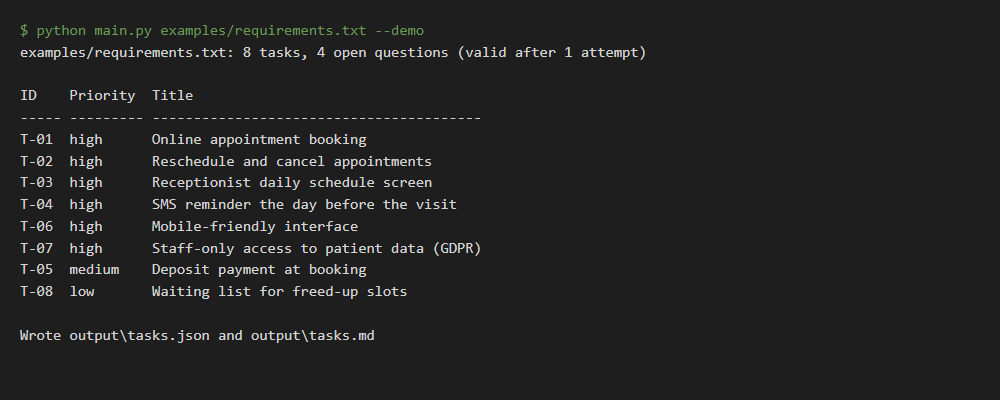
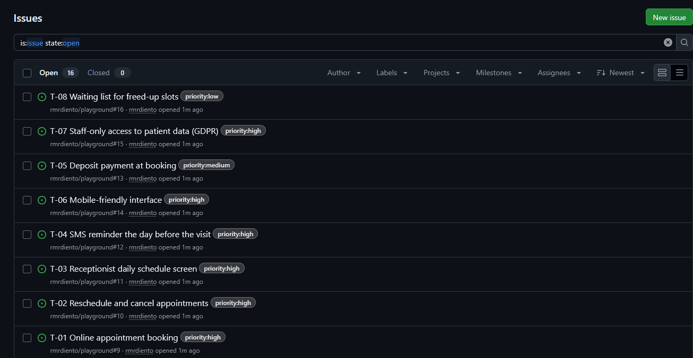

# Requirements to Tasks

[](https://github.com/rmrdiento/requirements-to-tasks/actions/workflows/tests.yml)

A customer writes an email. A developer needs tickets. This command-line tool bridges the two: it sends the customer's text to an LLM (Claude API) and returns a prioritised task list as JSON and Markdown, with acceptance criteria, dependencies and a list of questions to ask the customer.

LLM output is never trusted blindly. Every reply is checked against a JSON Schema plus a few business rules, and rejected replies are logged and sent back to the model for correction.



## Before and after

**Before** - what the customer sent (`examples/requirements.txt`, synthetic):

> We run a small dental clinic with three dentists and would like to replace our paper diary with an online booking system. Patients should be able to book, move and cancel their own appointments from the website without calling us. The receptionist needs one screen that shows today's appointments for each dentist. Patients must get an SMS reminder the day before the visit, because no-shows cost us a lot of money. We also want to take a deposit when booking, but we have not decided on the amount yet. Everything has to work on phones. [...] It would be nice to have a waiting list that offers freed-up slots to other patients. We would like to launch before the summer holidays.

**After** - what the team gets (`output/tasks.md`, shortened):

| ID | Priority | Task | Depends on |
| --- | --- | --- | --- |
| T-01 | high | Online appointment booking | - |
| T-02 | high | Reschedule and cancel appointments | T-01 |
| T-03 | high | Receptionist daily schedule screen | T-01 |
| T-04 | high | SMS reminder the day before the visit | T-01 |
| T-06 | high | Mobile-friendly interface | - |
| T-07 | high | Staff-only access to patient data (GDPR) | - |
| T-05 | medium | Deposit payment at booking | T-01 |
| T-08 | low | Waiting list for freed-up slots | T-01, T-02 |

Each task also carries a description, acceptance criteria and the exact sentence of the request it came from. Vague points become questions instead of invented requirements:

- What is the deposit amount, and is it refunded when a patient cancels?
- What is the exact launch date? "Before the summer holidays" is not a date.

## Quick start

Python 3.11+ is required.

```bash
python -m venv .venv && source .venv/bin/activate   # Windows: .venv\Scripts\activate
pip install -r requirements.txt
python main.py examples/requirements.txt --demo
```

`--demo` replays the recorded response in `examples/tasks.json` through the full validation and rendering pipeline, so you can try the tool without an API key. That file is a hand-written sample of the output format, not a live model run.

To use the real model:

```bash
export ANTHROPIC_API_KEY=...        # Windows PowerShell: $env:ANTHROPIC_API_KEY = "..."
python main.py my_requirements.txt
```

Results are written to `output/tasks.json` and `output/tasks.md`. Options: `-o` output folder, `--model`, `--max-attempts` (default 3), `--log`.

## Send tasks to GitHub Issues

```bash
export GITHUB_TOKEN=...             # token with permission to create issues in the repo
python main.py my_requirements.txt --github-issues owner/repo --dry-run   # preview
python main.py my_requirements.txt --github-issues owner/repo             # create
```



Each task becomes one issue through the GitHub REST API (`POST /repos/{owner}/{repo}/issues`): title `T-01 ...`, a checklist of acceptance criteria, the dependencies, the customer's original sentence, and a `priority:high|medium|low` label. Issues are created only after the reply passed validation. If GitHub rejects a request the tool stops and reports how many issues already exist, so re-running would duplicate them; check the repo first.

## How validation works

1. The model gets the requirements plus the JSON Schema (`schema/tasks.schema.json`) and must answer with one JSON object.
2. The reply is parsed (code fences and surrounding prose are tolerated) and checked against the schema: required fields, priority in `high | medium | low`, id format, no extra fields.
3. Business rules the schema cannot express: ids are unique, every dependency exists, there are no dependency cycles, and every `source_quote` really appears in the customer's text (this catches invented requirements).
4. On failure the problem is appended to `errors.log` (JSON lines: time, attempt, error kind, messages, the raw reply) and the errors are sent back to the model. After `--max-attempts` failures the tool exits with code 1 and writes no output files.

Exit codes: `0` success, `1` model output rejected or API call failed, `2` usage error (for example no API key).

## Tests

```bash
pytest
```

The model is replaced by a scripted fake, so tests run offline: valid reply, JSON in code fences, repair after a bad reply, giving up, API failure, ten kinds of invalid output, and the CLI end to end.

## Limits

- The tests never call the real API; behaviour of the live model is only as good as the prompt and the retry loop.
- Input is a plain-text file. Very long documents are not split into chunks.
- All example data is synthetic.
